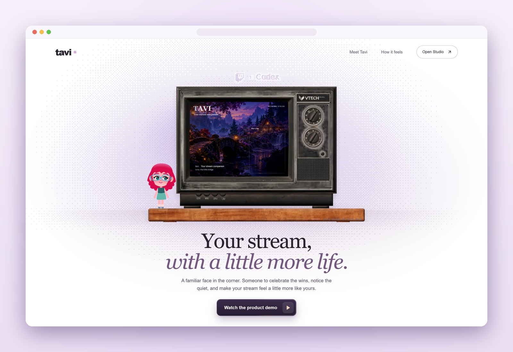
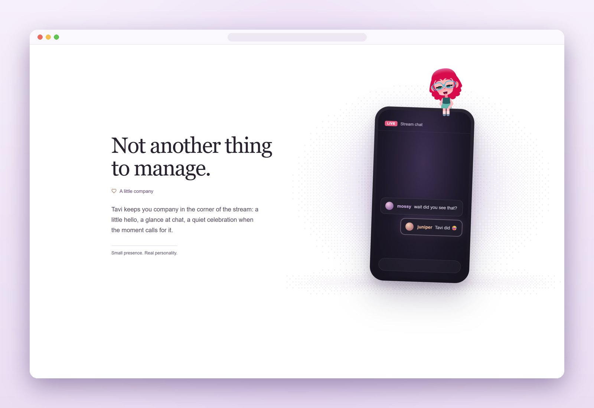
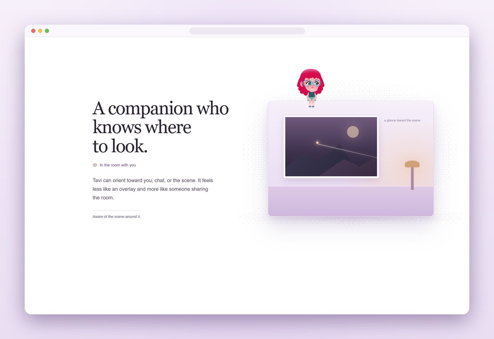
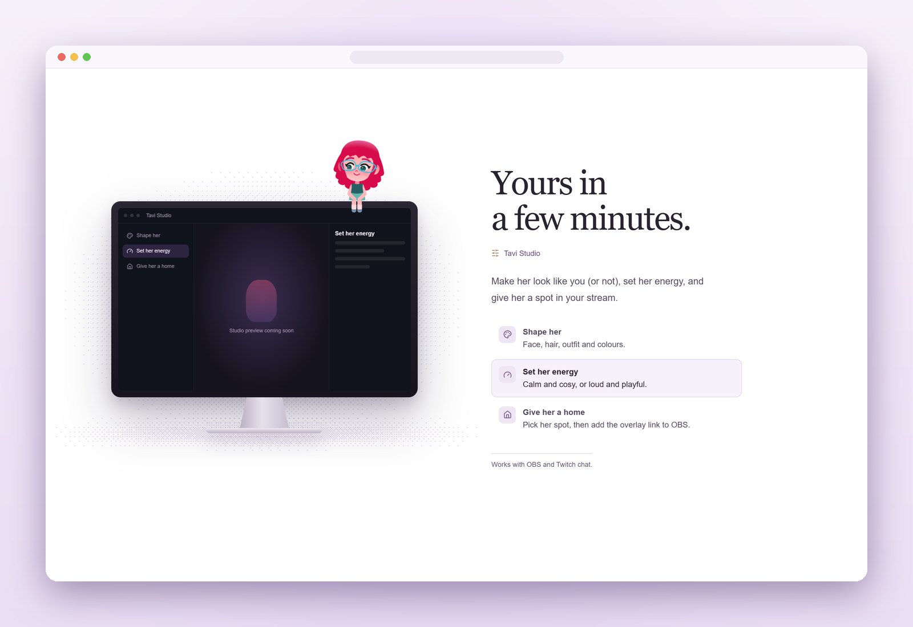
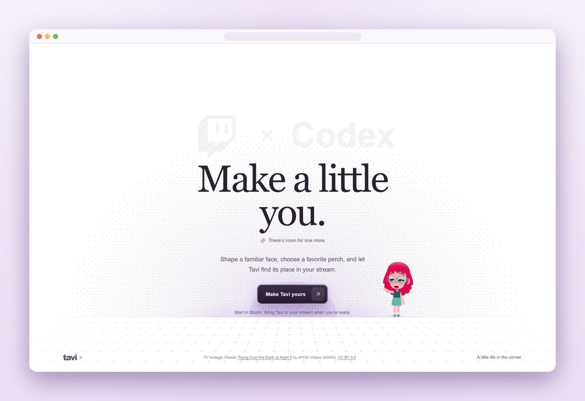
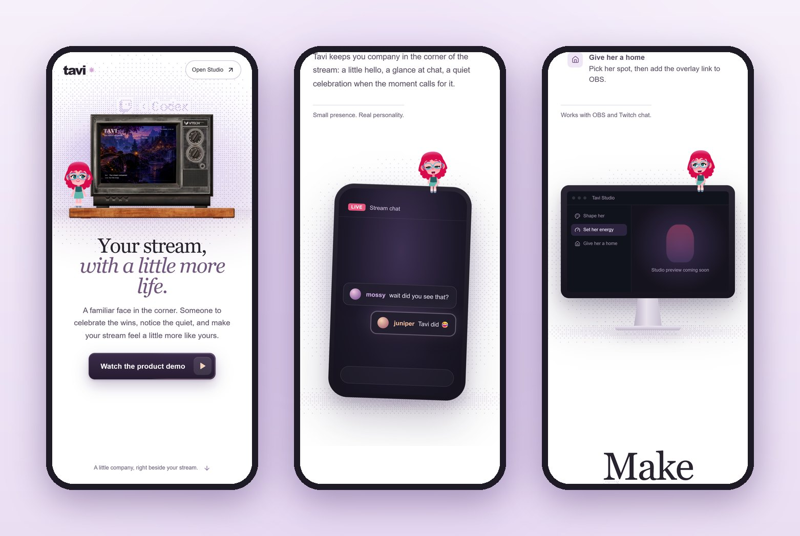
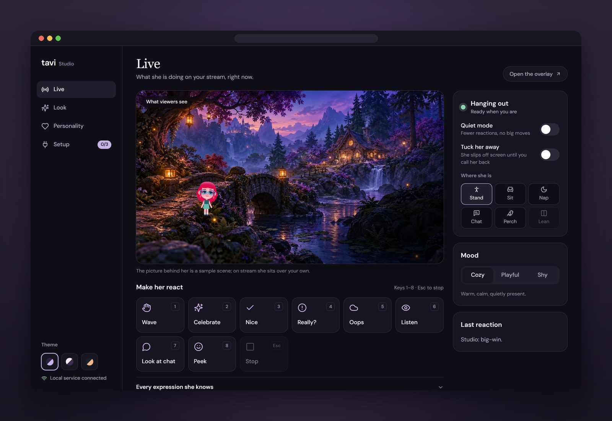

 

# Tavi

STREAM COMPANION&nbsp;&nbsp;·&nbsp;&nbsp;TWITCH × CODEX HACKATHON

A customizable, expressive chibi companion that hangs out in a streamer's OBS canvas. Built for the Twitch x Codex hackathon.

  
  
  
  
  
  

  <a href="#for-judges"><b>For judges</b></a>&nbsp;&nbsp;·&nbsp;&nbsp;
  <a href="#a-look-around"><b>A look around</b></a>&nbsp;&nbsp;·&nbsp;&nbsp;
  <a href="docs/RUNNING.md"><b>Run it</b></a>&nbsp;&nbsp;·&nbsp;&nbsp;
  <a href="docs/STATUS.md"><b>What works</b></a>&nbsp;&nbsp;·&nbsp;&nbsp;
  <a href="#connect-twitch"><b>Connect Twitch</b></a>&nbsp;&nbsp;·&nbsp;&nbsp;
  <a href="#documentation"><b>Docs</b></a>

 

## FOR JUDGES

Tavi is an expressive companion for Twitch streamers: customize her in Studio, add the transparent overlay to OBS, and let chat become small on-screen reactions.

| What to review                    | Where to look                                                                                                                                             |
| --------------------------------- | --------------------------------------------------------------------------------------------------------------------------------------------------------- |
| Run and evaluate Tavi             | [Judge walkthrough and capability boundaries](docs/JUDGING.md#try-tavi) / [source setup](docs/RUNNING.md) / [Windows app instructions](desktop/README.md) |
| How Codex was used                | [Codex development README](docs/codex/README.md), including concrete examples, source links, and attribution                                              |
| Codex session IDs                 | [Session registry](docs/codex/README.md#session-ids) / [recorded primary ID](.session_id). Primary build thread confirmed by the creator.                 |
| Twitch connection and interaction | [Connect Twitch](#connect-twitch) / [event reactions and cooldowns](docs/STREAM-EVENT-REACTIONS.md)                                                       |
| Submission materials              | [Demo video, project description, and submission checklist](docs/JUDGING.md#submission-materials). Video and Devpost project URLs are pending.            |
| Architecture, checks, and credits | [Technical review map](docs/JUDGING.md#technical-review-map) / [validation commands](docs/DEVELOPMENT.md#validate) / [asset credits](public/credits/)     |

Primary Codex build session: `01a17704-cc9a-7d01-822a-754a6062ab3c` (confirmed by the creator).

The landing page is an authored product demonstration. For live Twitch evidence, follow the judge walkthrough and show the OBS overlay responding to actual channel activity. This landing review revision uses the core rules path. ChatGPT sign-in and extended stream-event work are documented as awaiting integration; they are not included in this PR. Microphone input and spoken voice are not implemented.

Requirements were checked against the [hackathon overview](https://twitchcon-codex.devpost.com/) and [official rules](https://twitchcon-codex.devpost.com/rules). See the [readiness checklist](docs/JUDGING.md#before-submitting) for outstanding submission steps.

## Project description

Tavi is a customizable animated companion for livestreamers. It lives in an OBS Browser Source and can wave, emote, move between scene positions, tuck away, and react to chat with small, personality-aware gestures. Streamers can adjust Tavi's appearance, wardrobe, personality, and placement in the studio. Twitch chat reactions use bounded rules and cooldowns; the current build does not make AI-generated decisions or replies. The reaction playground is clearly labeled as a demo, so simulated events are not presented as live stream activity.

## A look around

<table>
  <tr>
    <td width="50%"></td>
    <td width="50%"></td>
  </tr>
  <tr>
    <td>
<b>Reads the room.</b> Tavi follows you down the page, perching on each section and reading the chat as it lands.
</td>
    <td>
<b>Knows where to look.</b> Every stop is a small scene: what she watches, how she feels, where she sits.
</td>
  </tr>
  <tr>
    <td width="50%"></td>
    <td width="50%"></td>
  </tr>
  <tr>
    <td>
<b>Yours in a few minutes.</b> Studio, staged on its own display, with Tavi on top.
</td>
    <td>
<b>Lands with you.</b> At the bottom she drops to the floor and wanders by the call to action.
</td>
  </tr>
</table>

  
   
  <b>Made for small screens too.</b> The same story, laid out for a phone.

### Tavi Studio

  
   
  <b>Companion studio.</b> Shape her look, try gestures and poses, set her personality, and copy the overlay URL for OBS.

## How we used Codex

See the [Codex development README](docs/codex/README.md) for the confirmed build session, collaboration record, implementation evidence, and attribution. It distinguishes this revision from work awaiting integration.

## Connect Twitch

The registered public Client ID is built into `shared/twitch.ts`; it is not a secret. Start Tavi and click **Connect Twitch**. Open the displayed Twitch authorization link in your browser and approve read-chat access. The registered Twitch app must use the **Public** client type. This device-code flow does not use a callback URL or client secret. If Tauri does not open the link yet, use **Copy authorization link** and paste it into your system browser. The desktop owner can integrate that link with Tauri's external-browser opener.

After approval, Tavi listens to the authorized account's own channel using Twurple EventSub WebSockets. Recent chat appears in the studio. Messages addressing the companion by name or saying `Tavi` can produce a small personality-dependent gesture, with a 30-90 second cooldown based on chat engagement. Quiet mode, retraction, and zero chat engagement suppress these reactions. These are rule-based live reactions, not AI-generated responses. No chat messages are sent by Tavi.

Access and refresh tokens remain in Node service memory, never browser storage or overlay state. Restarting the service requires reconnecting. During a session, Tavi validates tokens, refreshes before expiry, and handles revocation. Disconnect clears local state and attempts Twitch token revocation. Chat history is bounded and held only in memory; Twitch deletion and clear events remove messages from the panel.

Live credentials are not needed for automated tests: Twitch HTTP and EventSub boundaries use controlled fixtures. Real end-to-end account authorization and chat delivery require approval in the streamer's browser.

Twitch UI smoke check: with the dev server running, execute `node tools/twitch-browser-check.mjs`. It uses browser route fixtures and does not authorize an account or send chat.

## Documentation

|                                                |                                                                                              |
| ---------------------------------------------- | -------------------------------------------------------------------------------------------- |
| [Run the proof of concept](docs/RUNNING.md)    | Install, run the landing page and studio, add the OBS overlay, and run the production build. |
| [What works now](docs/STATUS.md)               | What the current build does, and what is not connected yet.                                  |
| [Repository layout](docs/REPOSITORY-LAYOUT.md) | Where the studio, renderer, service, tests and tooling live.                                 |
| [Reproduce the tooling](docs/TOOLING.md)       | Vendored agent skills, the lockfile, and how to verify or restore them.                      |
| [Landing page vision](docs/LANDING-VISION.md)  | The story the landing page tells, and how Tavi moves through it.                             |
| [Landing page notes](docs/LANDING-NEXT.md)     | Loading, motion language, idle life and the page descent as built.                           |
| [Development](docs/DEVELOPMENT.md)             | Validation, formatting, typing, browser smoke checks and pull request reviews.               |
| [Tavi Studio](docs/STUDIO-STAGE.md)            | The four Studio screens, the OBS dock, and their browser checks.                             |
| [Plan](docs/PLAN.md)                           | The four-day build and four-day refinement targets.                                          |
| [OBS and webcam](docs/OBS-WEBCAM.md)           | Placing Tavi in OBS beside a webcam.                                                         |
| [Desktop app](desktop/README.md)               | The Tauri shell and its packaging.                                                           |
