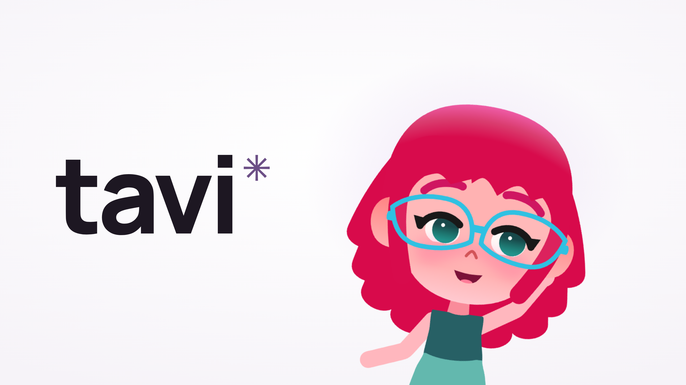
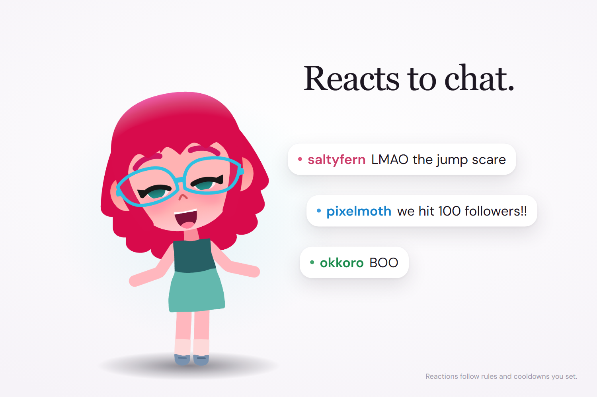
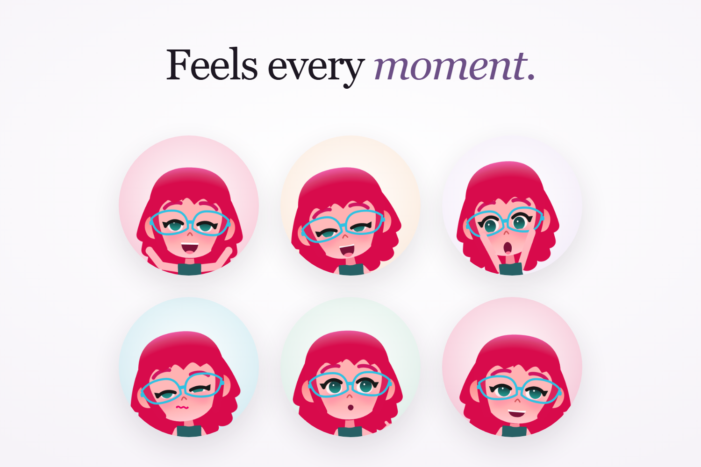
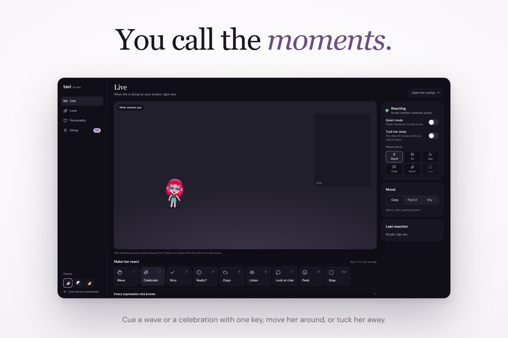

<div align="center">



# Your stream, with a little more life.

An expressive companion for Twitch streamers. Give Tavi a place in OBS, a personality, and a room full of chat.

**[Meet Tavi](https://tavi-pi.vercel.app)** ? **[Try the preview](https://tavi-pi.vercel.app/judge)** · **[Windows downloads](https://github.com/Daniel-Shunom/Tavi/releases)** · **[Run locally](docs/RUNNING.md)** · **[For judges](#for-judges)**

<sub>Built for the Twitch × Codex hackathon · React · TypeScript · Rive · Tauri</sub>

</div>

## FOR JUDGES

| Start here                                                | What you'll find                                                                                                                                 |
| --------------------------------------------------------- | ------------------------------------------------------------------------------------------------------------------------------------------------ |
| [Judge walkthrough](docs/JUDGING.md#try-tavi)             | Try the app, connect Twitch, and evaluate the OBS overlay.                                                                                       |
| [Browser preview](docs/JUDGING-SESSIONS.md)               | Isolated 30-minute sessions, labeled test events, reset, and one 15-minute extension. [Open the live preview](https://tavi-pi.vercel.app/judge). |
| [How we used Codex](docs/codex/README.md)                 | Development workflow, implementation evidence, attribution, and session IDs.                                                                     |
| [Submission checklist](docs/JUDGING.md#before-submitting) | Public demo video and Devpost project links are **pending**.                                                                                     |
| [Checks and architecture](docs/DEVELOPMENT.md#validate)   | Validation commands; [source map](docs/REPOSITORY-LAYOUT.md) and [asset credits](brand/CREDITS.md).                                              |

**Primary Codex session:** `01a17704-cc9a-7d01-822a-754a6062ab3c` · [All recorded sessions](.sessions)

The landing animation and illustrated chat below are authored demonstrations. Test events are labeled; live Twitch operation requires channel authorization. Microphone input and spoken voice are not implemented.

## Project description

Tavi lives in a transparent OBS Browser Source. She waves, emotes, walks, sits, naps, peeks, and tucks away while you stream. Studio controls her appearance, personality, placement, and reactions. Twitch chat uses bounded rules and cooldowns; manual controls and quiet mode keep the streamer in charge.

<table>
  <tr>
    <td width="50%"></td>
    <td width="50%"></td>
  </tr>
</table>

## Her place on your stream



**Live** for quick reactions. **Look** for appearance. **Personality** for her temperament. **Setup** for Twitch and OBS.

Tavi Foundation is the default model. Other models remain in beta; supported customization depends on the selected model. Existing customized legacy looks are preserved, with an explicit switch to Foundation.

## Get started

Download the Windows installer from [GitHub Releases](https://github.com/Daniel-Shunom/Tavi/releases) when a release is available. For the desktop setup and unsigned-installer notes, see [Windows app instructions](desktop/README.md). The macOS installer is coming soon.

For local development, use Node.js 22.12+, npm, and Python 3.10+:

```sh
npm ci
npm run dev
```

Open [Studio](http://127.0.0.1:5173/studio). Add an OBS Browser Source with `http://127.0.0.1:5173/overlay`, at 1280 × 720. Keep the local service running.

For the isolated browser preview, follow the [judging-session setup](docs/JUDGING-SESSIONS.md#run-the-local-judging-preview). Hosted sessions use a separate overlay URL and expire on the server.

## Connect Twitch

Choose **Connect Twitch** in Studio, then approve the read-only permissions in Twitch's browser flow. Tavi listens to the authorized account's channel; she does not send chat messages. Quiet mode, retraction, and cooldowns bound automatic reactions.

Twitch tokens remain in service memory. Disconnect clears them locally and attempts revocation. Judging sessions also disconnect on reset or expiration. [Connection and reaction details →](docs/STREAM-EVENT-REACTIONS.md)

## Built with Codex

Human direction shaped the character, product, visual style, and priorities. Codex helped implement and refine Studio, motion, integration code, packaging, and verification. The [development record](docs/codex/README.md) documents concrete examples, session evidence, collaborator attribution, and feature boundaries.

## Documentation

| Build and run                                        | Go deeper                                       |
| ---------------------------------------------------- | ----------------------------------------------- |
| [Local setup and OBS](docs/RUNNING.md)               | [Expression system](docs/EXPRESSION-SYSTEM.md)  |
| [Windows app](desktop/README.md)                     | [Permanent motion lab](docs/motion/RIG-LAB.md)  |
| [Browser judging sessions](docs/JUDGING-SESSIONS.md) | [Rig foundation](docs/motion/RIG-FOUNDATION.md) |
| [Development and checks](docs/DEVELOPMENT.md)        | [Repository layout](docs/REPOSITORY-LAYOUT.md)  |
| [Agent skills and tooling](docs/TOOLING.md)          | [Brand and submission assets](brand/README.md)  |

```sh
npm test
npm run build
python tools/skills.py
```

## Credits

Character adapted from **[Mascot / Avatar Customization](https://rive.app/marketplace/27479-51911-mascot-avatar-customization/)** by **alisketch**, licensed under **[CC BY 4.0](https://creativecommons.org/licenses/by/4.0/)**. Tavi adds rigging, expressions, motion, and staged/cropped media. No endorsement is implied.

Landing scenery includes Poly Haven's Television 01 by Gabriel Radić and Wooden Table 02 by Serhii Khromov (CC0), and the credited APOD/NASA Earth footage. See [all asset credits](public/credits/) and [media attribution blocks](brand/CREDITS.md).
